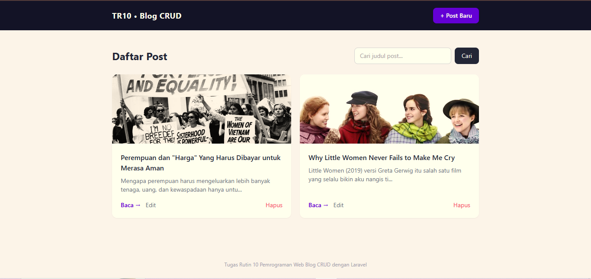
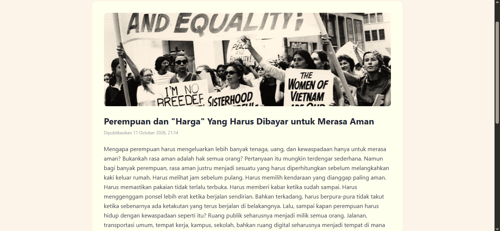
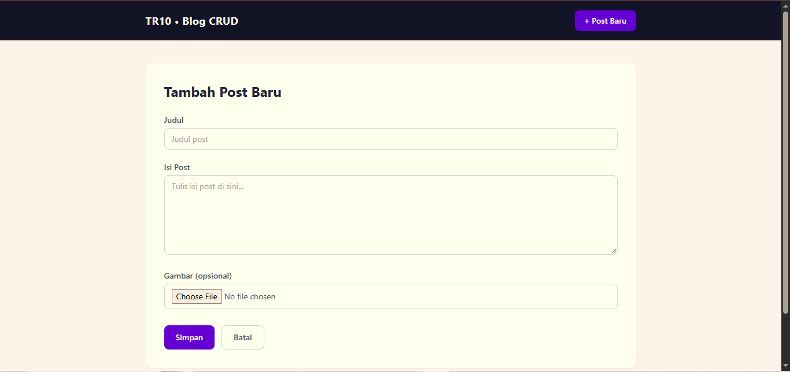
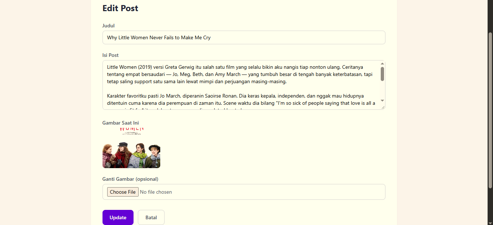

# Tugas Rutin 10 — Blog CRUD Laravel

Blog sederhana pakai Laravel Resource Controller — full CRUD (Create, Read,
Update, Delete) dengan validasi, flash message, Blade components, route
model binding, dan pagination.

## Fitur

- **Route::resource('posts')** — otomatis bikin 7 route standar + nama
  (`posts.index`, `posts.create`, `posts.store`, `posts.show`,
  `posts.edit`, `posts.update`, `posts.destroy`)
- **PostController** sebagai resource controller (7 method: index, create,
  store, show, edit, update, destroy)
- **Blade layout master** (`layouts/app.blade.php`) pakai `@extends` /
  `@yield` di semua halaman
- **2 Blade component**:
  - `<x-alert />` — nampilin flash message sukses/gagal + error validasi
  - `<x-card :post="$post" />` — kartu preview post di halaman daftar
- **Validasi lengkap** — error per field ditampilkan, input lama nggak
  hilang kalau validasi gagal (`old()`)
- **Flash message** sukses/gagal tiap aksi (tambah/update/hapus)
- **`@csrf`** di semua form + **`@method('PUT')`** / **`@method('DELETE')`**
  buat form update & hapus
- **Route Model Binding** — `{post}` di URL otomatis di-resolve jadi object
  `Post` di Controller
- **Pagination** — 6 post per halaman
- **Bonus:**
  - Pencarian post by judul
  - Soft delete (post yang dihapus nggak beneran ilang dari database,
    cuma ditandai `deleted_at`)
  - Upload gambar untuk tiap post

## Struktur Folder (yang relevan buat tugas ini)

```
app/
├── Http/Controllers/
│   └── PostController.php     (7 method resource)
└── Models/
    └── Post.php                 (pakai SoftDeletes)

database/
└── migrations/
    └── ..._create_posts_table.php

resources/views/
├── layouts/app.blade.php         (layout master, @yield)
├── components/
│   ├── alert.blade.php            (komponen 1: flash & error message)
│   └── card.blade.php              (komponen 2: kartu preview post)
└── posts/
    ├── index.blade.php              (daftar + search + pagination)
    ├── create.blade.php              (form tambah)
    ├── edit.blade.php                 (form edit, pre-filled)
    └── show.blade.php                  (detail post)

routes/
└── web.php                          (Route::resource)
```

## Cara Menjalankan di Komputer Sendiri

### 1. Buat Project Laravel Baru

```
composer create-project laravel/laravel tugas-p10-blog-crud
cd tugas-p10-blog-crud
```

(Kalau muncul error soal ekstensi PHP seperti `zip` atau `fileinfo` belum
aktif, buka `php.ini` kamu dan hapus `;` di depan baris `extension=zip`,
`extension=fileinfo`, dll — sama kayak waktu TR9.)

### 2. Siapkan Database

```
mysql -u root -p
```
```sql
CREATE DATABASE db_tugas_p10;
EXIT;
```

### 3. Konfigurasi `.env`

Buka `.env`, ubah bagian `DB_*` jadi:
```
DB_CONNECTION=mysql
DB_HOST=127.0.0.1
DB_PORT=3306
DB_DATABASE=db_tugas_p10
DB_USERNAME=root
DB_PASSWORD=isi_password_mysql_kamu
```

### 4. Hubungkan Folder Upload Gambar

Supaya gambar yang diupload bisa diakses lewat browser, jalankan:
```
php artisan storage:link
```
(cuma perlu sekali, bikin shortcut dari `public/storage` ke `storage/app/public`)

### 5. Salin File-File dari Tugas Ini

Salin semua file dari folder tugas ini ke project Laravel kamu, sesuai
struktur folder yang sama (lihat tabel struktur folder di atas):

- `routes/web.php` → timpa yang lama
- `app/Http/Controllers/PostController.php` → file baru
- `app/Models/Post.php` → file baru
- `database/migrations/..._create_posts_table.php` → file baru
- `resources/views/layouts/app.blade.php` → file baru (bikin folder `layouts` dulu)
- `resources/views/components/alert.blade.php` → file baru (bikin folder `components` dulu)
- `resources/views/components/card.blade.php` → file baru
- `resources/views/posts/index.blade.php` → file baru (bikin folder `posts` dulu)
- `resources/views/posts/create.blade.php` → file baru
- `resources/views/posts/edit.blade.php` → file baru
- `resources/views/posts/show.blade.php` → file baru

### 6. Migrate

```
php artisan migrate
```

### 7. Jalankan

```
php artisan serve
```

Buka `http://127.0.0.1:8000` — langsung masuk ke daftar post. Coba semua
fiturnya: tambah post (dengan/tanpa gambar), cari post, edit, hapus.

## Catatan

- Slug dibuat otomatis dari judul (`Str::slug()`) + timestamp, biar unik
- Gambar lama otomatis dihapus dari storage kalau diganti gambar baru
  waktu edit post
- Delete pakai **soft delete** — kalau mau lihat post yang udah "dihapus"
  masih ada di database (kolom `deleted_at` keisi), itu normal, sesuai
  requirement bonus

## Screenshot Aplikasi

### Daftar Post


### Detail Post


### Form Tambah Post


### Form Edit Post

